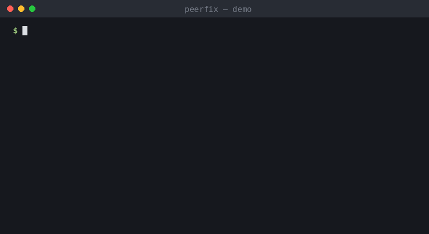

# peerfix

Stop copying `--legacy-peer-deps` without knowing why. `peerfix` explains npm's `ERESOLVE` errors in plain English and gives you the exact commands to fix them.



```
npm error ERESOLVE unable to resolve dependency tree
```

## Usage

No install needed:

```bash
npx peerfix
```

Pass any arguments you would give to `npm install`:

```bash
npx peerfix react-dom@18
```

## Example output

```
Dependency conflict detected:
  react-foo@2.1.0 wants react@^17.0.0
  but your project has react@18.2.0

1. Update react-foo
   react-foo@2.1.0 requires react@^17.0.0.
   → npm install react-foo@latest

2. Force react@18.2.0 for react-foo
   Keeps react@18.2.0 via an override. Verify react-foo still works.
   → peerfix --apply  (adds overrides.react-foo.react)

Tip: `peerfix --apply` writes option 2 into package.json.
```

## Why not `--legacy-peer-deps`?

That flag silences the error without fixing anything. npm stops installing peer dependencies, and the bug usually shows up later, in production or in a different environment. `peerfix` shows you the exact conflict so you can pick a real fix.

## What it does

1. Runs `npm install` with your arguments.
2. If it fails with `ERESOLVE`, it finds the package that causes the conflict, the range it requires, and the version you have installed.
3. Prints two fixes: update the package, or add an `overrides` entry (`--apply` writes it for you).

## Limitations (v0.1)

- Supports the error format used by npm 7 and later. Other errors are printed as-is.
- `--apply` adds an `overrides` entry to `package.json`. Always check that the affected package still works afterwards.
- pnpm and yarn are not supported yet.

## Development

```bash
git clone <your-repo-url>
cd peerfix
npm test
```

## License

MIT
